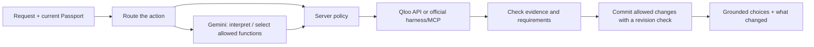

# TastePassport AI

**Move anywhere. Keep your vibe.**

TastePassport is an agent-powered cultural discovery app for people making a new city feel like home. Tell it what you already love—a film, an artist, a cuisine, a book—and it helps you find places and culture in your destination, refine those choices through conversation, find common ground with someone else, and shape a day out. You can explore without creating an account.

**[Try the Cloud Run demo](https://taste-passport-ai.cloud.run/)** · [Project guide](docs/PROJECT_GUIDE.md) · [MIT license](LICENSE)

## Why we built it

Moving changes more than an address. A newcomer often knows what they love but not where those tastes might lead in a new city. A generic city guide starts with popularity. A general-purpose chatbot can offer plausible ideas, but its answer alone does not confirm which *Interstellar* or *A.R. Rahman* the person meant, retrieve Qloo's cultural associations, or carry verified preferences through later decisions.

TastePassport starts with **confirmed cultural interests** and makes a useful next step from them. The user stays in control: they can correct a match, set a budget or other supported requirements, reject a suggestion, ask a follow-up, or choose the stops in an outing.

## What to try as a judge

1. Pick a destination and add **one to five interests**. For example, try *A.R. Rahman*, *Interstellar*, and *Indian cuisine*. The home city is optional and labels your journey; it does not silently infer your tastes.
2. Review the suggested identity for each interest. The dropdown contains other returned matches so you can correct a title or name before discovery.
3. Choose the activities you want to explore. Open a recommendation to see what evidence is available: its type, place details where returned, and an explanation that distinguishes an audience-taste association from a proven personal preference.
4. Ask TastePassport something specific, such as **“Find quieter Indian food within a moderate budget. Keep my movies unchanged.”** Check which section changed and whether the choices meet the request. Follow with **“Make those cheaper.”**
5. Save a promising choice to **My Vibe**. Try **Together** with another confirmed interest to look for shared cultural ground. Build **A day out** by choosing stops and times; reorder stops without silently replacing their venues.
6. Optionally create an account to save a Passport, a dated plan, or a named taste profile for another destination.

Live coverage varies by city and interest. The app should show a gap when Qloo does not return a suitable choice rather than manufacture a venue. For a recorded demo, use the results the app actually returns.

## Why Qloo changes the answer

| A standalone LLM answer | TastePassport's Qloo-grounded workflow |
|---|---|
| Suggests plausible places from general knowledge, which may be stale or hard to verify. | Retrieves named entities and supported metadata from Qloo, then checks output type, locality, exclusions and observable constraints. |
| May guess which artist, film or food concept the user meant. | Presents returned candidates for explicit confirmation before using them as taste signals. |
| Can explain a recommendation fluently without evidence for that particular connection. | Uses returned tags, query provenance and available contribution evidence; it labels collective associations honestly. |
| Treats a follow-up as a new prompt unless an application carries state. | Keeps a revision-checked Passport with confirmed interests, category preferences, feedback and conversation context. |
| Can propose a group outing in prose. | Uses Qloo Compare for shared cultural associations and lets people assemble an outing from returned place choices. |

This describes the **difference in workflow and evidence**, not a measured claim that every TastePassport result beats every LLM answer. Gemini is valuable for understanding language and selecting tools; Qloo supplies the cultural entities and discovery candidates that the app can inspect and preserve.

The integration uses Qloo [entity search, tags, Insights and Compare](https://docs.qloo.com/reference/qloo-llm-hackathon-developer-guide), plus validated official harness/MCP functions where appropriate. In an Insights request, `filter.type` is the **requested output type**. An artist and a film can be input signals while `urn:entity:place` requests places. Food, coffee and cinema are place activities selected with supported taxonomy, not made-up entity types. Music results are artist discoveries, not verified local concerts.

## How the agent works



The Next.js API owns the turn. Native Gemini function calling through `@google/genai` can propose an action or tool call; **the server decides what is allowed**, executes Qloo requests, validates returned IDs and user constraints, and updates only the relevant Passport sections. Read-only questions can use already-returned evidence without another search. The tool loop and retries are bounded, and guided controls remain available when conversation is unavailable. Backend logs record safe stages and status, not keys, account tokens, chat transcripts or raw provider payloads.

Discovery first checks identity and hard requirements, then ranks and diversifies eligible results. Matching-domain tastes guide familiar choices; Balanced can blend direct and adjacent Qloo results; Explore can surface more adjacent discoveries. Chain and duplicate limits reduce repetitive previews. These are product ranking rules, **not Qloo-issued probabilities**. The [project guide](docs/PROJECT_GUIDE.md) documents retrieval, ranking, sessions and failure behavior in more detail.

## Architecture and data

| Part | Responsibility |
|---|---|
| Next.js 16, React, TypeScript | Onboarding, Discover, Ask TastePassport, My Vibe, Together, insights and the outing planner |
| Qloo API and official harness/MCP | Resolve interests and concepts; retrieve cultural entities, places and shared associations |
| Gemini via `@google/genai` | Interpret conversational requests and select permitted functions; compose responses from checked facts |
| Server-side policy and session state | Validate requests, preserve unaffected preferences, reject unsupported results and coordinate revisions |
| Supabase (optional) | Email/password accounts, saved Passports, plans, taste profiles, destinations and persisted editing sessions |
| Google Cloud Run | Host the public Next.js application |

Guest discovery needs Qloo but no account. If account storage is configured, the browser receives only an active-session pointer; canonical editing state stays on the server. Saved Passports hold bounded Qloo-backed discoveries and preferences, not chat history or provider credentials.

## Run it locally

Use **Node.js 24+** and npm. Install dependencies, copy the example configuration to a Git-ignored local file, and run the app:

```sh
npm ci
cp .env.example .env.local
npm run dev -- --port 3000
```

Open `http://localhost:3000`. Set these **server-side** values in `.env.local` or your host's secret settings:

| Setting | Purpose |
|---|---|
| `QLOO_API_KEY` | Required for live Qloo discovery. Obtain a hackathon-enabled key. |
| `QLOO_API_BASE_URL` | Use `https://hackathon.api.qloo.com`. |
| `GEMINI_API_KEY` or `GOOGLE_API_KEY` | Enables native Gemini conversation through Vertex AI Express Mode. `GOOGLE_API_KEY` takes precedence if both are set. |
| `GEMINI_MODEL` | Configurable model; the code defaults to `gemini-3.1-flash-lite`. |
| `SUPABASE_URL`, `SUPABASE_PUBLISHABLE_KEY`, `SUPABASE_SERVICE_ROLE_KEY` | Optional together for accounts and durable saved data. Keep the service-role key server-only. |
| `APP_ORIGIN` | Canonical origin for account email redirects, for example `http://localhost:3000` locally or the deployed HTTPS origin. |

The `AGENT_MODEL_*` compatibility adapter is optional for other providers; native Gemini does not need it. Do not put any provider or service-role secret in a `NEXT_PUBLIC_` variable, a commit, logs or screenshots.

For account features, create a Supabase project, enable email/password authentication and the desired email-confirmation setting, configure the local and deployed `/auth/callback` redirect URLs, then run [db-scripts/setup.sql](db-scripts/setup.sql) **manually once** in its SQL Editor. **That script deletes existing app-owned Passports, plans, profiles and active sessions.** It preserves Auth users and existing destination rows. Do not run it in CI or on every deployment. Without Supabase configuration, use the guest discovery flow.

## Verify and deploy

```sh
npm run check:docs
npm test
npm run typecheck
npm run build
npm run smoke:production
```

Those checks use local fixtures and a production smoke test; they do not certify live Qloo, Gemini or email delivery. Opt-in live checks are `npm run verify:qloo`, `npm run verify:gemini`, `npm run verify:accuracy` and `npm run verify:relevance`; they consume provider quota. For the hosted demo, also test a complete guest journey and the account flow if you intend to show it.

The app can be deployed to Cloud Run from GitHub. It listens on the host-provided `PORT` and exposes `/api/health` for process readiness. Configure secrets in the host, set `APP_ORIGIN` to the public HTTPS origin, and verify a real discovery and refinement in addition to the health response. GitHub Actions validates pushed `feat/**` branches. **[Open the live demo](https://taste-passport-ai.cloud.run/).**

## Boundaries and submission

TastePassport does not book venues, verify current opening hours or showtimes, guarantee travel times, or certify dietary or medical safety. Some Qloo entities have no image, rating or usable venue details; the UI must not infer missing facts. Geographic affinity and aggregate audience patterns do not describe an individual.

We built this for the [Qloo Agentic Hackathon](https://qloo.devpost.com/): a specific use case where an agent becomes more useful when it knows what people love. The public code is available under the [MIT license](LICENSE). Judges and other teams can start with this README, inspect the [project guide](docs/PROJECT_GUIDE.md) for implementation details, and run the app with their own credentials.
