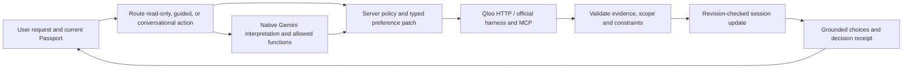

# TastePassport AI — project guide

This is the single reference for the product, Qloo integration, agent design, development, deployment, demo, and submission. The [root README](../README.md) is the short entry point for judges.

## Product and customer journey

Moving cities changes daily routines, but a generic city guide starts from popularity rather than the music, films, food, and other culture a newcomer already loves. TastePassport lets a person bring one to five confirmed interests to a supported destination, discover Qloo-returned places and cultural entities, adapt a Passport through conversation, and turn choices into an outing. Discovery is available to guests.

1. Pick a destination and one to five interests. An optional home city labels the Passport cover; it does not fetch origin-city recommendations or infer a background.
2. Confirm ambiguous named entities. Taxonomy concepts such as cuisine and dietary options use returned Qloo tags rather than invented identifiers.
3. Choose discovery categories. The application requests output entity types appropriate to each category, then validates and ranks returned candidates. Place cards can contain available address, image, business rating, and price metadata. Cultural content is not presented as a local event.
4. Refine one or more sections with Ask TastePassport or guided controls. Explicit constraints and untouched categories remain intact. My Vibe saves liked cards within the Passport; rejected cards guide future relevant retrieval.
5. Compare confirmed profiles through Together. Qloo Compare returns shared cultural associations that inform joint discovery; a match is not a claim of personal compatibility.
6. Build an outing from actual place options, select a date and suggested local times, reorder stops without replacing venues, and swap a stop deliberately. The planner does not book or verify hours, routes, or showtimes.
7. Optionally sign in. Named taste profiles can be reused in another city; saved Passports retain the current discoveries and My Vibe; upcoming plans are separate. An already-saved active Passport updates after successful edits. A fresh Passport in the same city does not overwrite an older saved one until explicitly saved or reopened.

The default demo journey is Bengaluru → Toronto with A.R. Rahman, *Interstellar*, and Indian cuisine. Confirm the exact artist and film; then ask for cheaper vegetarian Indian food while keeping Music and Movies unchanged. Follow with “make those cheaper,” inspect the actual decision receipt, and plan dinner plus a cinema. Use only results returned by the live app when recording; change the script if a provider returns different choices.

## Why Qloo is essential

Gemini interprets requests and writes grounded replies. Qloo supplies real cultural entities, associations, shared tastes, and discovery candidates. The application does not ask Gemini to manufacture restaurant names or a recommendation catalogue. A generic LLM may suggest city ideas, but it cannot supply the Qloo-returned entity IDs, query provenance, contributor evidence, or Compare result used in this workflow.

The hackathon [developer guide](https://docs.qloo.com/reference/qloo-llm-hackathon-developer-guide) describes the hackathon host `https://hackathon.api.qloo.com`. The server sends `X-Api-Key` from `QLOO_API_KEY`; credentials and raw provider responses never belong in the public repository. The main operations are:

| Qloo operation | Use in TastePassport |
|---|---|
| `/search` and entity details | Resolve named inputs and enrich returned entities before identity confirmation. |
| `/v2/tags` and `/v2/tags/types` | Resolve supported cuisine, dietary, dish, ambience, and venue concepts; the latter also supports diagnostics. |
| `/v2/insights/` | Retrieve real entities from confirmed tastes, the requested output type, locality and supported filters. |
| `/v2/analysis/compare` | Return shared associations for Together; both confirmed profiles inform follow-up discovery. |
| Special tag, geographic-affinity, and aggregate-demographic Insights | Supply optional cultural themes and area context where usable evidence exists. They are not a probability that an individual likes something. |
| Official harness/MCP (`qloo_find_tags`, `qloo_rank`) | Execute validated model-selected taxonomy lookup and eligible shortlist ranking. |

`filter.type` selects the **output** entity domain. Normal entity output types are `artist`, `book`, `brand`, `destination`, `movie`, `person`, `place`, `podcast`, `tv_show`, and `video_game`, prefixed by `urn:entity:`. Input tastes may come from different domains. Dining, cafés, and cinemas are place activities distinguished by taxonomy, not separate entity types. Music cards represent artist discovery rather than verified local concerts. A recorded hackathon-host compatibility case maps the documented `urn:entity:video_game` to the wire spelling `urn:entity:videogame` at the HTTP boundary.

`src/qloo/query-plan.ts` allowlists parameters by output type. `src/qloo/verify-result.ts` and the agent validate returned identity, locality, exclusions, and observable numeric limits. Missing price or rating metadata does not satisfy a strict maximum or minimum. Place geography differs from content audience geography; neither proves travel time or live event availability. Cuisine and dietary requirements remain conjunctive. “Vegetarian options” is not evidence of allergen or medical safety.

Cards retain available Qloo metadata, query inputs, and returned contribution evidence. Audience associations are explained as such; they do not prove that an artist caused someone to like a particular venue or that two films share a plot. Explanations state when only collective evidence is available. Affinity values are not presented as universal match probabilities. Entity image URLs come from Qloo when available; the interface falls back visibly when an image cannot load. Original decorative assets are separate from recommendation evidence.

## Agent architecture

TastePassport is one stateful agent with bounded tool use. A Next.js API route owns the turn; Gemini uses the native `@google/genai` SDK with Vertex AI Express Mode; server policy owns authorization and state changes.



- `app/page.tsx` and `app/components/` project the current Passport and provide typed actions. `app/api/agent/turn` streams bounded turn events. `src/agent/orchestrator.ts` routes, validates, executes, and commits. `src/qloo/` plans and checks provider requests/results. `src/account/` owns authentication and account persistence.
- The native model sees the latest request, current cultural preferences, a compact summary of validated decisions, and up to four recent cultural messages under a 2,400-character cap. Account records, API keys, raw provider payloads, and an unbounded transcript are excluded. Current requests and explicit requirements outrank earlier conversation.
- Recognized read-only questions use existing evidence without regenerating cards. Guided controls can act without a model call. Conversational requests use Gemini for semantic intent; supported dynamic workflows can select Qloo tools through native function calling. Model output proposes an action; server validation decides what is executable.
- New concepts are resolved through Qloo taxonomy. An unresolved named entity can become a pending confirmation. A new request supersedes an old pending draft, preventing stale “choose noodles” loops.
- A bounded function-call observation loop can execute up to three authorized `qloo_find_tags` calls for a user message, followed by one tool-free model response. It rejects unadvertised tools, duplicate queries, and unsupported arguments. `AGENT_TOOL_LOOP=0` disables that optional loop. Established discovery can use validated direct HTTP or official harness paths without an unnecessary model-selected tool call on every turn.
- The final native response receives validated outcomes and a small set of returned choice facts. Server checks reject unsupported references and metrics. A deterministic receipt reports the actual changes and retains a useful reply when composition fails. The model cannot insert invented entities into cards.
- A canonical revision-checked session stores selected tastes, city, category preferences, modes, cards, feedback, pending clarification and bounded conversation memory. A successful refinement commits only after validation; failures preserve existing usable results. Requests for the same session are serialized. Reset Conversation clears conversation and refinement context; New Passport clears the active Passport.
- Metadata-only backend logs expose request and trace IDs, stages, tool names, counts, statuses, and elapsed time: Gemini attempted → tool selected → Qloo/MCP invoked → result returned. They omit credentials, prompts, transcripts, raw API responses, and account tokens.

Provider, tool, and Qloo failures can activate a clearly labelled guided path. That path is not reported as a successful native Gemini call. Model and tool steps have timeouts and bounded retries appropriate to their transport; HTTP validation failures are not treated as retryable service outages.

### Relevance and ranking

Candidate identity and hard requirements are checked before ranking. Matching-domain seeds get priority for familiar content: film tastes are the primary film signals, artist tastes the primary artist signals. Cross-domain associations can still add adjacent discovery. Familiar and Explore use direct or adjacent grounded pools. Balanced uses weighted reciprocal-rank fusion (0.75 direct / 0.25 adjacent, rank constant 60) and may reserve up to four of twenty places for adjacent-only results when a direct pool exists. Deduplication, branch/chain limits, and bounded first-three diversity reduce repetitive place choices while preserving the leading relevant candidate. These are product policies, not Qloo-issued match probabilities or a certified relevance score. Strict user filters remain strict across all three modes; results can legitimately overlap.

## Accounts, state and database

Guest discovery needs Qloo but no account. With Supabase configured, Auth supports optional sign-in and profile ownership. `saved_passports` stores a bounded snapshot with My Vibe, feedback, and per-category preferences; it excludes chat history and credentials. `taste_profiles` stores portable confirmed tastes and compatible preferences for another destination. `saved_plans` stores dated outing stops/times. Server-only `active_passport_sessions` preserves the editable session across process restarts. `destinations` is an editable catalogue, not a city check constraint on saved rows.

The only schema file is [db-scripts/setup.sql](../db-scripts/setup.sql). **It is destructive to app-owned saved Passports, plans, taste profiles, and active sessions.** It preserves Supabase Auth users and existing destination rows, then inserts starter destinations only when absent. Run it manually in the Supabase SQL Editor for a fresh/reset environment. Do not run it during deployment or CI. Set `SUPABASE_URL`, `SUPABASE_PUBLISHABLE_KEY`, and server-only `SUPABASE_SERVICE_ROLE_KEY`; set `APP_ORIGIN` to the deployed HTTPS origin. Test registration, email confirmation, login, save/restore, deletion, and ownership with real accounts before including those actions in a demo.

The browser stores only a per-tab active-session pointer for signed-in refresh. The server reloads canonical state; the pointer cannot create a lost session. A separate per-tab marker permits automatic snapshot updates only after that exact session was explicitly saved or reopened. Deleting the saved Passport clears the marker while keeping the current active view. Guest tab recovery holds a bounded local Passport view but requires a valid server session before edits or saves.

## Run and verify

Requires Node.js 24+ and npm. Install from the lockfile and create an ignored local environment file:

```sh
npm ci
cp .env.example .env.local
npm run dev -- --port 3000
```

`QLOO_API_KEY` and `QLOO_API_BASE_URL=https://hackathon.api.qloo.com` enable live discovery. `GEMINI_API_KEY` (or `GOOGLE_API_KEY`, which takes precedence) and `GEMINI_MODEL` enable Vertex AI Express Mode. The default model is `gemini-3.1-flash-lite`; no Gemini base URL, GCP project, or location is required for this key mode. The optional OpenAI-compatible provider uses `AGENT_MODEL_*` variables separately. Keep all secrets server-side, out of `NEXT_PUBLIC_` names, command output, and commits. Provider quota and key permissions still apply.

```sh
npm run check:docs
npm test
npm run typecheck
npm run build
npm run smoke:production
```

These use local fixtures and do not prove current Qloo/Gemini availability. On October 21, 2026, this code passed a production build, all 387 unit/integration tests, production smoke, and an isolated Chromium account UI contract with mocked account APIs. The browser contract includes signed-in refresh, retained My Vibe and per-category preferences, delete confirmations, and no empty-profile loading flash. Re-run on the submitted commit. Mocked account responses are not proof of Supabase email or ownership behavior.

Opt-in provider probes, which consume quota, include `npm run verify:gemini`, `npm run verify:qloo`, `npm run verify:accuracy`, and `npm run verify:relevance`. `scripts/verify-account-ui.mjs` requires an isolated Chromium CDP instance and a locally running production build; it mocks account endpoints. Real hosted acceptance remains separate. `npm run spike` is a feasibility diagnostic, not the consumer demo.

Deployment on Google Cloud Run uses the Node/Next.js production build, listens on the platform `PORT`, and exposes `/api/health`. GitHub CI runs checks for a pushed branch; the connected Cloud Run build trigger builds and deploys the selected branch. Compare the deployed commit to the submitted branch before judging. The currently used release branch is `feat/discover-first-workspace-polish`; the repository default branch may differ. Use `https://taste-passport-ai.cloud.run/` for the public demo and `https://taste-passport-ai.cloud.run` for `APP_ORIGIN`. A successful health check alone does not validate the guest or agent journey.

## Security boundaries and deployment controls

Guest write endpoints, like account mutations, require the browser's Origin to match `APP_ORIGIN` (or the local server origin when unset). Set `APP_ORIGIN` to the public HTTPS origin you serve. Cross-site browser requests are rejected before body parsing or provider work. Scripts calling these browser endpoints must supply that Origin. This is a CSRF boundary, not authentication or protection against clients that forge headers. Guest session IDs remain bearer capabilities: never share or log them.

Request bodies are bounded while reading, including uploads without Content-Length. Model tool names and taxonomy arguments are allowlisted; extra fields, invalid limits, and out-of-request queries are rejected. Server-owned tool descriptions prevent catalog text from redefining capabilities. User, conversation and tool strings are untrusted data; application validation and state-commit checks enforce authority. Known configured secrets are rejected in cultural inputs and checked in model output. These checks supplement secret isolation; they do not guarantee detection of encoded secrets or every semantic prompt injection.

Responses include anti-framing, MIME-sniffing and referrer protections. The CSP constrains framing, objects and base URLs; it is not a complete script-source policy. Next.js is patched to 16.4.2. Run `npm audit --omit=dev` when releasing: the Qloo harness includes its own pinned dependency tree, so remaining transitive advisories require compatible upstream patches and review. Do not use `npm audit fix --force` to silently replace the integration.

Per-turn budgets and session locks limit individual operations; this app does not yet implement distributed request rate limiting. Before opening traffic widely, configure provider quotas, Cloud Run maximum instances and an edge rate-limiting policy. A Cloud Armor policy requires a supported load-balancer setup; a directly accessible Cloud Run URL must not bypass that boundary. Budget alerts notify rather than enforce a spending cap. Infrastructure controls and live ownership/email acceptance need separate deployment verification.

## Judge and submission guide

The [hackathon page](https://qloo.devpost.com/) asks for an agentic tool/app where Qloo’s cultural graph makes the result materially better than a generic LLM. Frame the project around **cultural continuity for a newcomer**, not the number of endpoints or cards. The published judging areas described in the project materials are technological implementation, design, potential impact, and quality of the idea. The submission should show a functional public demo, public code repository with an open-source license, and a clear project description; verify the current rules and field requirements on Devpost before final submission.

Suggested project name: **TastePassport AI — The Cultural Belonging Agent**. Elevator pitch: **Move anywhere. Keep your vibe. A Qloo-powered agent that carries your cultural tastes into a new city, adapts to feedback, and helps you find common ground.**

For the project story: explain the relocation problem, the guest journey, actual Qloo endpoint roles, native Gemini function calling plus server-side validation, Together and planning outcomes, the difficulty of ambiguous names and constraint preservation, and what was learned about evidence-backed explanations. List Next.js, React, TypeScript, Node.js, Qloo, Gemini, `@google/genai`, MCP, Supabase, PostgreSQL, and the actual hosting platform used by the submitted build. State limitations honestly; do not claim measured superiority from an illustrative model-only comparison. The repository includes [MIT](../LICENSE).

### Four-minute demo outline

1. **0:00–0:25 — Human hook.** “You can move your belongings; moving your sense of belonging is harder.” Show a real destination and tastes.
2. **0:25–1:05 — Qloo proof.** Confirm exact interests, generate discoveries, show a few strong returned choices and one evidence-backed explanation. Show that an input film or cuisine changes a relevant domain only if the live result actually demonstrates it.
3. **1:05–2:05 — Agent proof.** Ask a constrained multi-part refinement; show the request/tool/Qloo/result trace in safe logs if recording allows. Point out the actual changed category, retained categories, and a concrete choice. Follow with a contextual cheaper request.
4. **2:05–2:45 — Together.** Confirm another profile, show returned common-ground associations and a useful joint discovery. Avoid presenting a compatibility score that Qloo did not return.
5. **2:45–3:35 — Practical outcome.** Select dinner and a real cinema, choose times, reorder without swapping venues, and show what the user must verify independently.
6. **3:35–4:00 — Why this architecture matters.** Gemini understands intent; Qloo provides real cultural evidence; server policy preserves trust and continuity.

Use actual app screenshots for media (identity confirmation, discovery, agent refinement, Together, outing), preferably 3:2 and under Devpost’s file-size limit. Do not stage invented cards, successful-agent messages, prices, or travel times. Confirm the live URL, submitted branch, license, media access, eligibility, and deadline while signed out. No video URL or externally verified submission status is implied by this repository.

## Boundaries and remaining acceptance

TastePassport does not book, verify live opening hours, certify menu ingredients/allergens, provide guaranteed route timing, or turn content recommendations into real events. Geographic audience affinity and aggregate demographics do not describe an individual. Returned image availability and category coverage vary by provider and destination. Failed searches keep earlier choices only when clearly distinguished from un-applied constraints. Before submission, rerun a signed-out hosted journey with real Qloo and Gemini, account save/restore if demonstrated, a complete outing, public source/license access, and the exact deployment commit.
